<p align="center">
  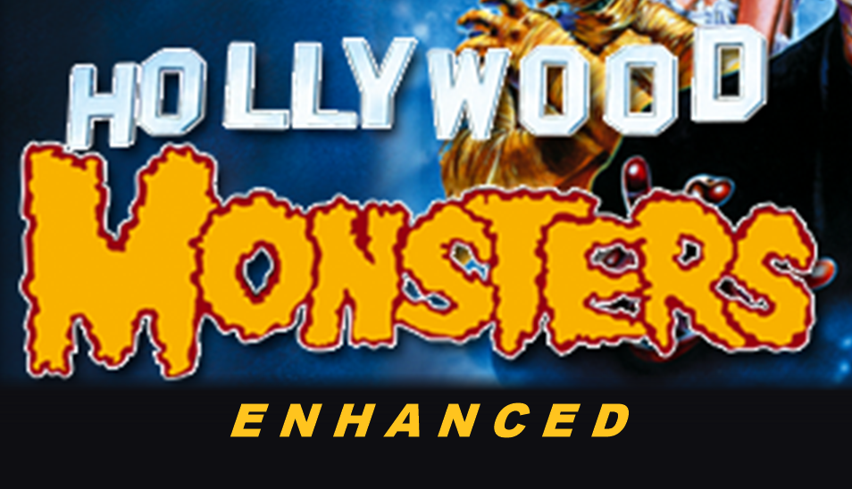
</p>

<h1 align="center">Hollywood Monsters Enhanced</h1>

Play Hollywood Monsters (Pendulo Studios, 1997) on Windows 10 and 11, with a new launcher, graphics filters and working sound settings. It also runs on Linux and on the Steam Deck: see [Linux and Steam Deck](#linux-and-steam-deck).

**Fully working with the Italian FX Interactive edition (2004).** The other editions should work too, with some small differences: the in-game sound sliders fix and the original start window are made for the Italian one, and I could not test the others because I don't own them. If something does not work with your edition, open an [issue](../../issues) and we'll talk about it: I'm open to fixing any problem that comes up.

The start window is the original FX one, redrawn sharper and bigger for today's screens. **Gioca** starts the game, **Options** opens the new settings, **Manuale di gioco** opens the manual and **Esci** closes it.

<p align="center">
  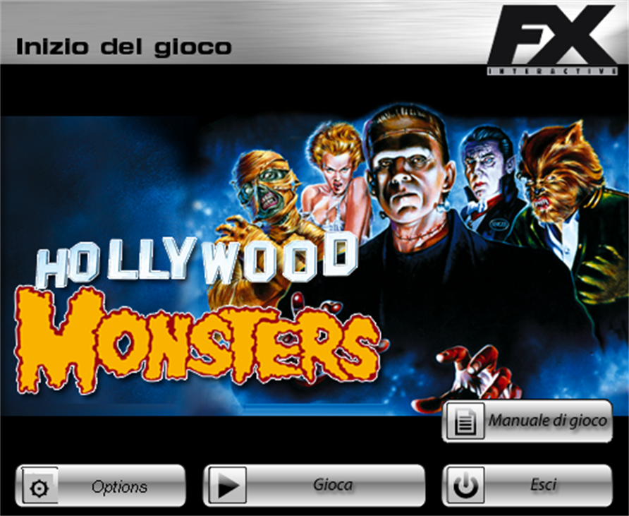
</p>

<p align="center">
  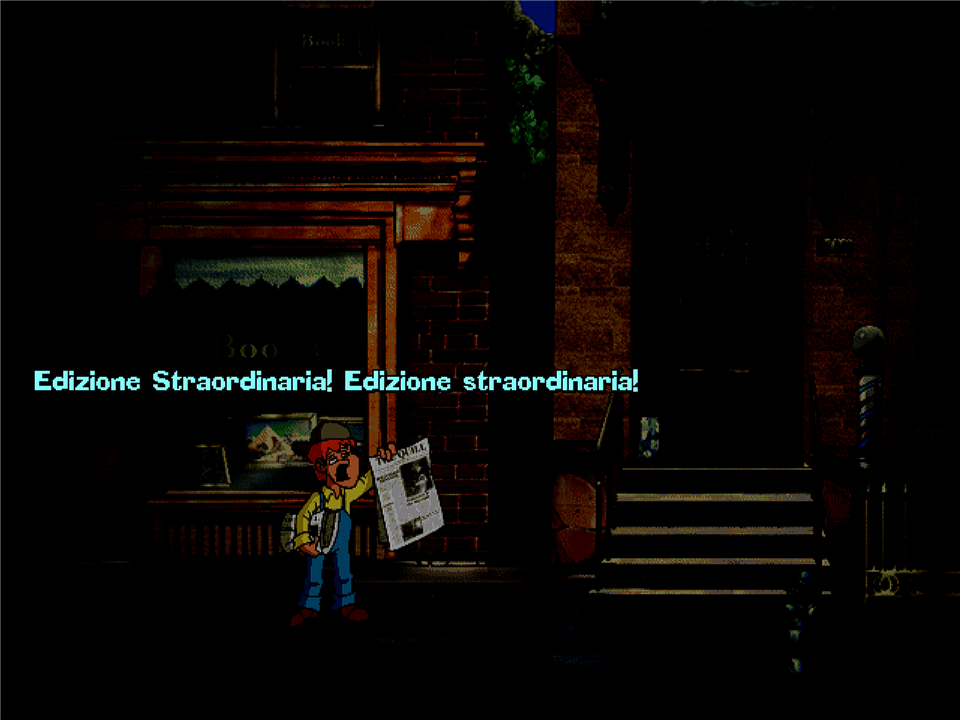
  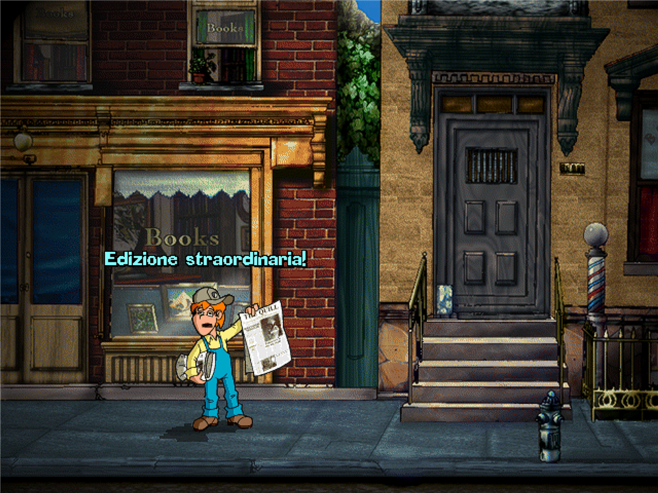
  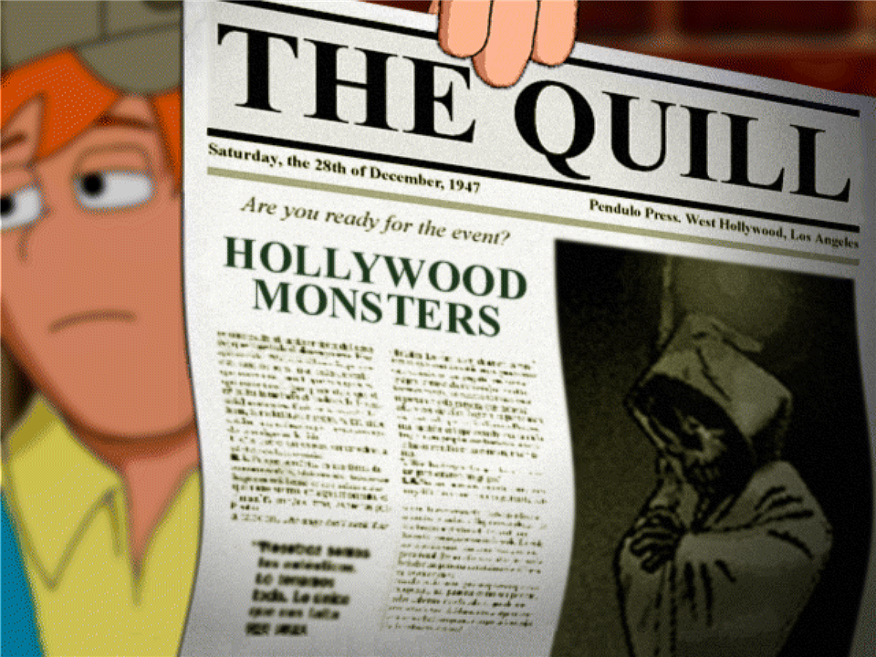
</p>
<p align="center">
  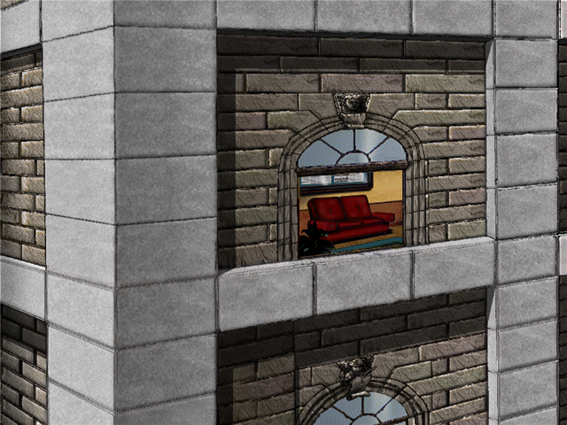
  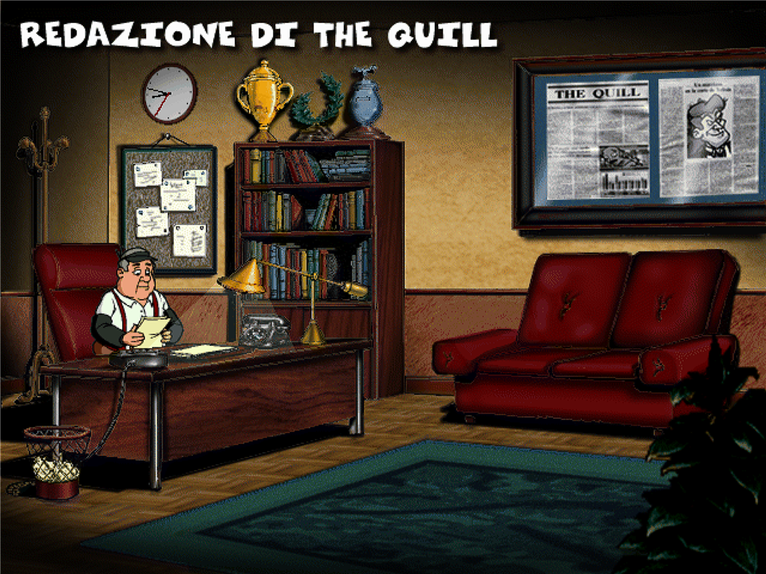
  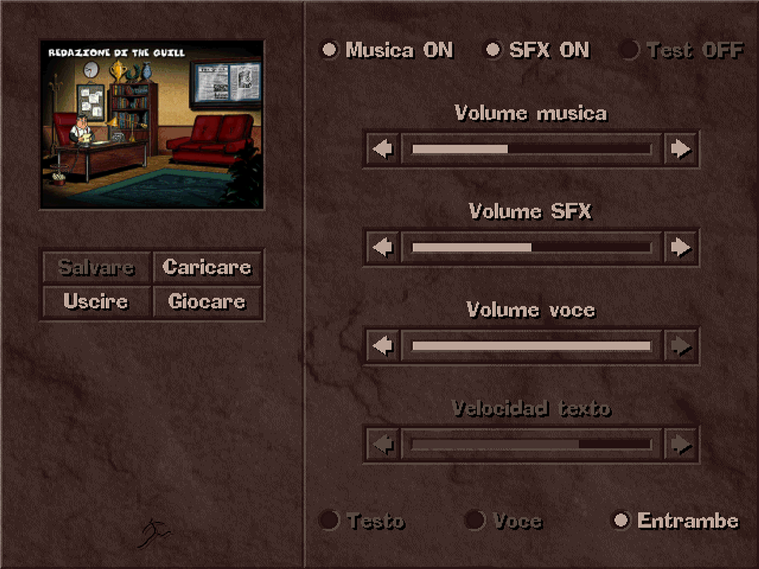
</p>
<p align="center">
  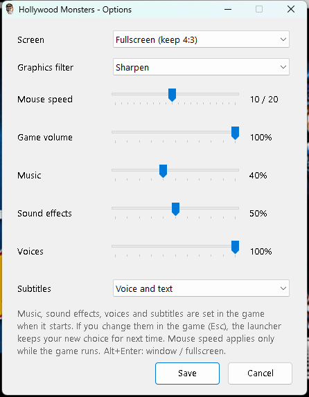
  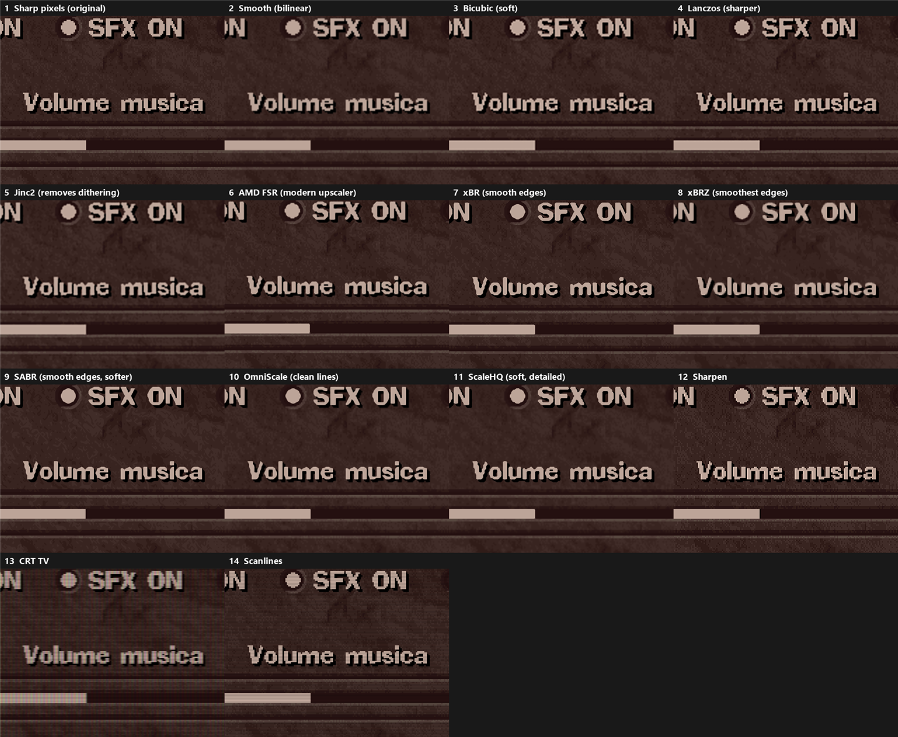
</p>

## Before and after

<p align="center">
  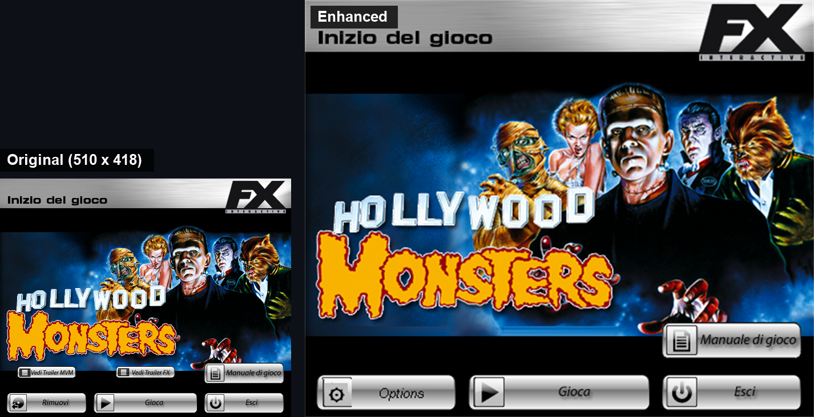
</p>
<p align="center"><em>The start window: the original at its real size, and the new one, scaled for today's screens.</em></p>

<p align="center">
  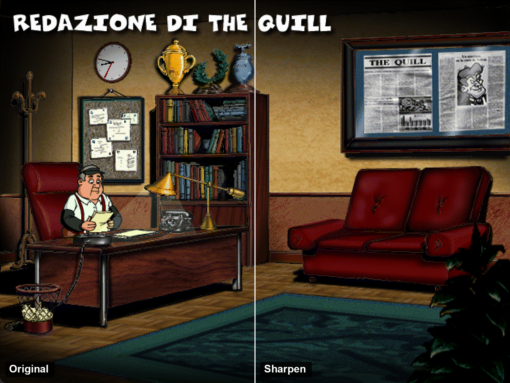
</p>
<p align="center"><em>Left half: the game's own 640 x 480 picture, pixel for pixel. Right half: the Sharpen filter, full screen.</em></p>

<p align="center">
  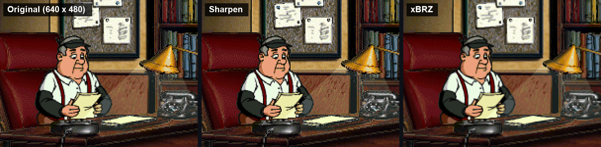
  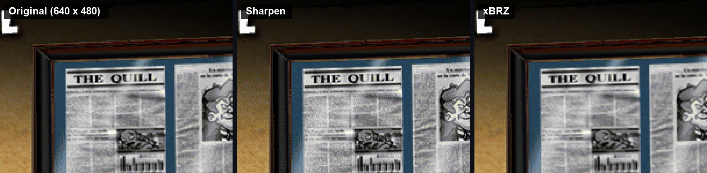
</p>
<p align="center"><em>Close-ups: the original pixels, Sharpen, and xBRZ (two of the 14 filters).</em></p>

<p align="center">
  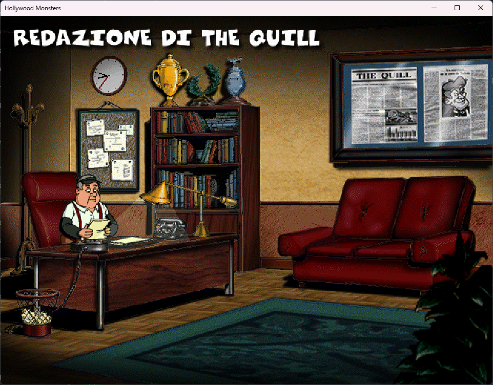
</p>
<p align="center"><em>The game in a 960 x 720 window; Alt+Enter switches to full screen. Without the fixes, the game switches the whole screen to 640 x 480.</em></p>

**The game installs from your own disc, starts on Windows 11, runs full screen or in a window with sharp or filtered pixels, and the music, sound effects and voice volumes now work.**

There may still be defects I have not found. If something does not work, please open an [issue](../../issues) and tell me what you did and what you saw, so I can fix it.

You need your own copy of the game: the CD or its .iso. No game files are included here.

## How to install

1. Download `HollywoodMonstersEnhanced.zip` from [Releases](../../releases/latest) and unzip it anywhere.
2. Insert the game disc, or keep the .iso file at hand.
3. Run `Setup.exe` and choose:
   - **Install from the disc, a mounted ISO or an .iso file**: it finds the disc by itself; for an .iso press **Browse...** and pick the file. Then choose where to install the game.
   - **Add the enhancements to a game I already installed**: pick the folder that has `monsters.exe`.
4. Press **Install**. When it says Done, press **Play**, or use the **Hollywood Monsters** icon on the desktop.

The setup does not need administrator rights and does not change anything in Windows. To remove everything, delete the game folder and the desktop icon.

## Linux and Steam Deck

The same download works on Linux and on the Steam Deck, through Wine or Proton (the programs that run Windows games there). The launcher notices it is running on Linux and sets itself up.

**So far it was tested only with Wine 10 on Ubuntu, not on a real Steam Deck and not with Proton.** If something does not work for you, please tell me in the [issues](../../issues).

On the Steam Deck, in Desktop Mode:

1. Download `HollywoodMonstersEnhanced.zip` from [Releases](../../releases/latest) and unzip it, for example in your Downloads folder.
2. Copy the files of your disc to the Steam Deck (it has no disc drive). If you have an .iso file, open it with the Ark app and extract it into a folder: the setup cannot open .iso files on Linux.
3. In Steam choose **Games > Add a Non-Steam Game to My Library**, press **Browse** and pick `Setup.exe`. In your library, right-click it, choose **Properties > Compatibility**, tick **Force the use of a specific Steam Play compatibility tool** and pick Proton. Start it.
4. In the setup press **Browse...** next to "Where is it?" and pick the folder with your disc's files (the one with the `Monsters` folder inside). The game goes into `Games/Hollywood Monsters` in your home folder. Press **Install**.
5. Add `Hollywood Monsters Launcher.exe` from that folder to Steam in the same way, with Proton, and play from there.

On other Linux computers: install Wine from your software centre, then in a terminal, in the unzipped folder, run `wine Setup.exe`. To play: `wine ~/Games/"Hollywood Monsters/Hollywood Monsters Launcher.exe"`.

What is different on Linux:

- The launcher's **Game volume** slider is greyed out: on Linux the launcher cannot change another program's volume. The music, sound effects and voices settings work; for the rest use the system volume.
- The setup does not make a desktop shortcut, and installs into `Games/Hollywood Monsters` in your home folder.
- Not checked yet: the mouse speed setting, a real Steam Deck, Proton, and playing with the Steam Deck's controls (the game is played with the mouse).

## What was done to make it work

- **Screen.** The game draws with DirectDraw at 640x480, which breaks on modern Windows. [cnc-ddraw](https://github.com/FunkyFr3sh/cnc-ddraw) replaces it, so the game runs full screen (4:3 or stretched) or in a window at 640x480, 960x720 or 1280x960. Alt+Enter switches between window and full screen.
- **Graphics filters.** 14 ways to scale the picture: sharp pixels as in 1997, smooth, Bicubic, Lanczos, Jinc2, AMD FSR, xBR, xBRZ, SABR, OmniScale, ScaleHQ, Sharpen, CRT TV and scanlines. They only change how the picture is scaled on screen; the game itself stays 640x480. The comparison picture above shows all of them.
- **Sound sliders.** In the game's menu the arrows next to the sliders jump straight from full to silent. The game moves a slider one step for each loop while the mouse button is held down, and today's PCs run that loop so fast that a normal click empties it. The launcher sets music, sound effects, voices and subtitles when the game starts, and remembers what you change in the game's menu for next time.
- **Game volume and mouse speed.** The launcher sets the volume of the whole game, and a mouse speed that applies only while the game runs; the Windows mouse speed comes back when it closes.
- **Saved games.** After each session the launcher copies your saved games to the `Save backups` folder, only when they changed, and keeps the last 20 copies.
- **Start window.** The original "Inizio del gioco" window, scaled for big screens, with a fade in and highlighted buttons. The trailer buttons are gone because the trailers are not installed, and "Rimuovi" became **Options**. The setup takes the picture from your own copy of the game.
- **Linux and Steam Deck.** Wine and Proton use their own DirectDraw, and with it the game stops at once with "Errore nell'installazione di Direct Draw". When the launcher sees it is running under Wine or Proton, it tells them to use cnc-ddraw for this game, so nothing has to be set by hand.

## Tested

- By me, by hand: the launcher, the start window, and the sound sliders in the game.
- By script on Windows 11, with Claude moving the mouse and pressing the keys and checking every screenshot: full screen and window modes, all 14 filters, the sound sliders (measured, see below), the setup from the .iso into an empty folder, and the launcher starting the game with the chosen volumes.
- By script on Linux (version 1.1), with Wine 10 on Ubuntu running inside Windows (WSL) and a virtual screen: unzipping the download, the setup from a folder with the disc's files into a new Wine, its message for .iso files, the start window, the options, the game with two filters, and the game's sound reaching the system (checked in the system's list of sounds, not listened to). Not on a real Steam Deck or with Proton.
- Not tested yet: installing from a real CD, other editions of the game (the original Spanish one by Dinamic Multimedia, 1997, for DOS; the FX Interactive Windows editions in other languages; a rare English one) (they should get everything except the sound sliders fix), saved-game backups with real saved games.

## Made with AI

Made with Claude (by Anthropic) on my own workstation.

Tools used:

- [Claude](https://www.anthropic.com/claude) by Anthropic
- [Hermes Agent](https://github.com/NousResearch/hermes-agent) by Nous Research
- [cnc-ddraw](https://github.com/FunkyFr3sh/cnc-ddraw) by FunkyFr3sh
- [libretro GLSL shaders](https://github.com/libretro/glsl-shaders)
- [DSOAL](https://github.com/kcat/dsoal) by kcat (tried, then removed)
- [GitHub CLI](https://cli.github.com)
- [Token Quotient](https://github.com/Korvonordico/quotient-claude-tokens)

## How to build

Both programs are built with the C# compiler that ships with Windows, nothing to install:

```
C:\Windows\Microsoft.NET\Framework64\v4.0.30319\csc.exe /nologo /target:winexe "/out:Hollywood Monsters Launcher.exe" src\Launcher.cs
C:\Windows\Microsoft.NET\Framework64\v4.0.30319\csc.exe /nologo /target:winexe /out:Setup.exe src\Setup.cs
```

## Credits

- Hollywood Monsters by Pendulo Studios; Italian edition by FX Interactive. This project is not affiliated with them.
- [cnc-ddraw](https://github.com/FunkyFr3sh/cnc-ddraw) by FunkyFr3sh (MIT license), with shaders from [libretro](https://github.com/libretro/glsl-shaders) (each under its own license).

## License

MIT for the launcher and the setup. See [LICENSE](LICENSE).

## How it was made, step by step (for the curious)

This part is only for those who want to know how the work went. I said what I wanted, tried the results and made the choices; Claude, running in Hermes on my PC, wrote the code and the scripts and ran the tests.

1. **Looking at the disc.** Claude opened the disc image read-only, without installing anything. It is the Italian FX Interactive edition, the whole game is in the `Monsters` folder of the disc, and all its programs are 32-bit.
2. **Installing.** The original installer asks for administrator rights and puts the game in "Program Files", where old games often cannot write their saved games. So the game was copied by hand to a normal folder.
3. **The screen.** Without fixes the game switched the whole screen to 640x480 and once closed with an error. dgVoodoo2 was considered, but cnc-ddraw was chosen because it is made for old 2D DirectDraw games like this one. It also fixed switching to other windows (Alt+Tab).
4. **The launcher.** A small program with the settings: full screen or window, window size, mouse speed only while the game runs, volume of the whole game, and a desktop icon. The Windows mouse speed comes back when the game closes.
5. **The graphics filters.** 14 filters were added and put side by side in one comparison picture, so the choice could be made by eye. I chose Sharpen for my own game. The filters only change how the 640x480 picture is scaled on screen.
6. **Saved games.** After each session the launcher copies the saved games to `Save backups`, only when they changed, and keeps the last 20 copies.
7. **The sound sliders, the hard part.** In the game's menu the arrows next to the music, effects and voice sliders jumped from full to silent. I tested it by hand and found that the sound was connected; only the steps were wrong.
   - Claude wrote a small program that reads the Windows sound meter, and a script that clicked the arrows, to measure what really changed.
   - DSOAL, which rebuilds the old DirectSound on modern Windows, was tried: it changed nothing, so it was removed. Slowing the game down with cnc-ddraw changed nothing either.
   - The cause: the game moves a slider one step for each loop while the mouse button is held down. Today's PCs run that loop so fast that a normal click (about a tenth of a second) empties the slider. The script's click was instant, so in the tests it moved only one step; that is why it seemed to work for Claude and not for me.
   - Changing the game's program was too risky. Instead, the places where the game keeps the volumes and the subtitles were found by comparing its memory before and after each change. The launcher now writes there your volumes and subtitles when the game starts, and every second reads them back, so what you change in the game's menu is remembered for next time.
8. **The original start window.** The FX "Inizio del gioco" window is made with Macromedia Director, so its pictures cannot be taken out easily. It was captured from the screen and redrawn bigger, without borders, with a fade in and buttons that light up. The trailer buttons were covered (the trailers are not installed) and "Rimuovi" became Options.
9. **The setup.** For other people, a setup that installs the game from their own CD, a mounted ISO or an .iso file, or adds the enhancements to a game already installed. It takes the start window picture from the user's own game, so no game art is shared here. It was tested by script, installing from the .iso into an empty folder, then a friend tried it on his own PC.
10. **This page.** Claude made the pictures and the text; I chose what to show and how.
